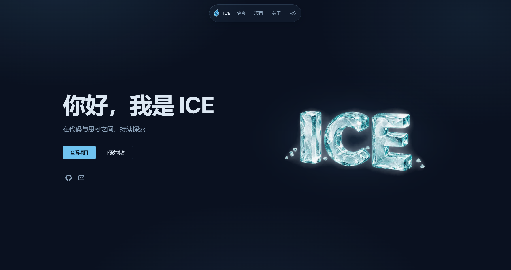
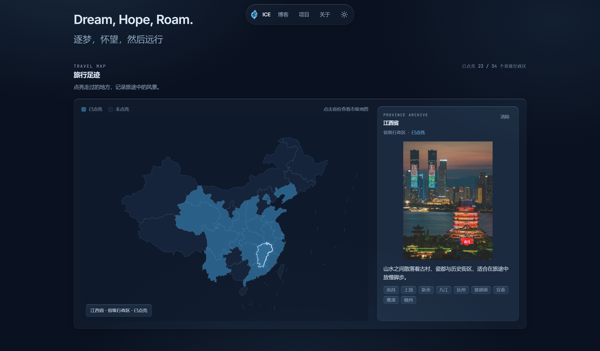
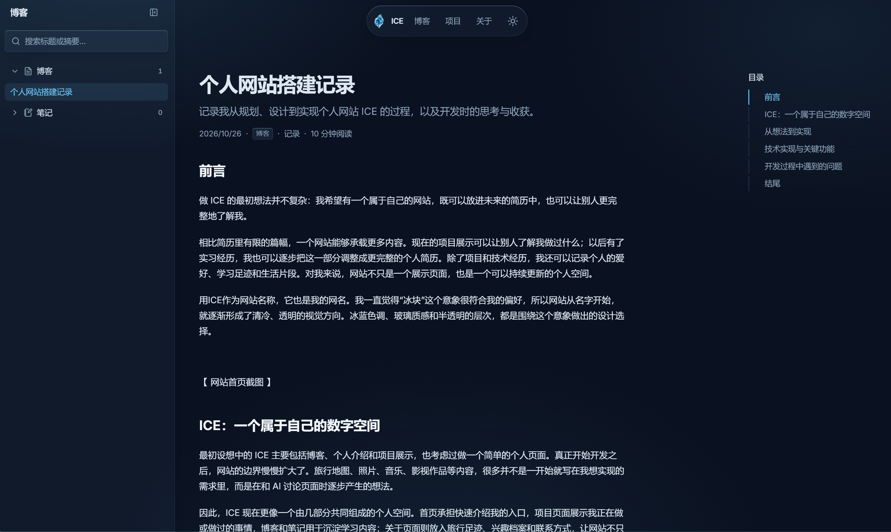
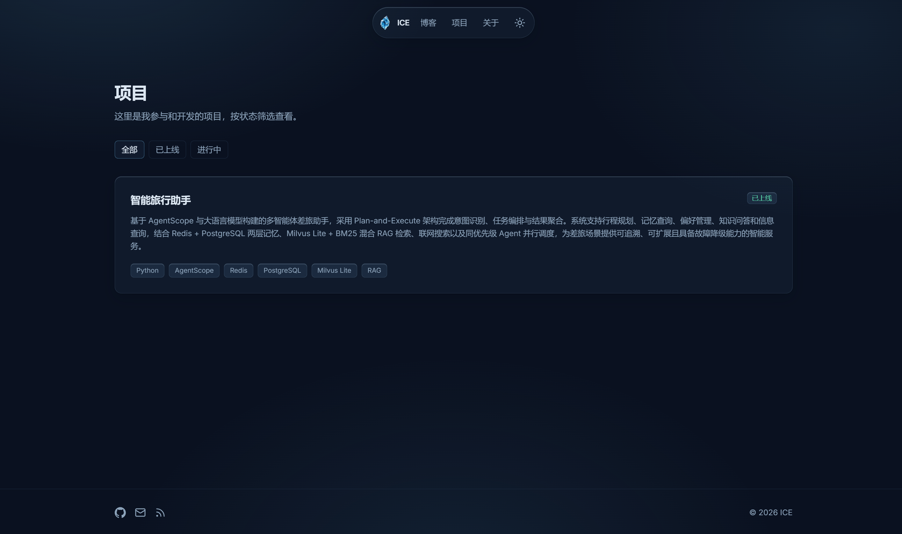
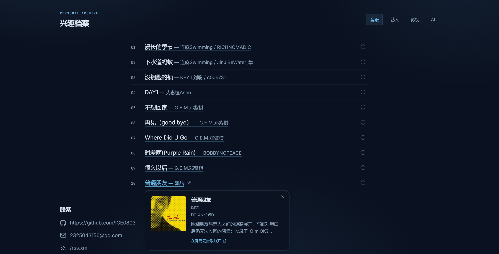

# ICE

个人主页、技术博客和个人生活记录网站。

> Dream, Hope, Roam.
> 逐梦，怀望，然后远行。

网站地址：[icedhr.vercel.app](https://icedhr.vercel.app/)

## 项目简介

ICE 是一个以个人主页为入口，记录技术实践、项目经历、旅行足迹和个人兴趣的个人网站。网站内容主要围绕个人学习过程记录，也保留音乐、影视等生活记录。

## 网站预览

### 首页



### 关于页面



### 博客页面



### 项目页面



### 兴趣档案



## 主要功能

### Home

- 展示个人介绍和当前关注的技术方向
- 展示精选项目和最新文章
- 支持浅色与深色主题切换，并记住用户选择

### About

- 展示个人理念和联系方式
- 通过可交互地图记录旅行足迹
- 支持从全国地图进入省级或地区视图，查看旅行日期、城市和照片
- 按分类展示音乐、影视、AI 和艺人等个人兴趣内容

### Blog

- 支持使用 Notion 数据库管理博客内容
- 支持博客和笔记两种内容类型
- Notion 未配置或请求失败时，可回退到仓库中的本地 MDX 内容
- 支持文章搜索、分类展示、相关文章和上一篇/下一篇导航
- 支持 Markdown、GFM、代码高亮、数学公式和文章目录
- 支持文章阅读进度、封面图片和正文图片展示

### Projects

- 展示个人项目、项目简介、技术信息和项目状态
- 提供项目详情页及对应的 GitHub 链接

### Interests

- 按分类记录音乐、影视、AI 等兴趣内容
- 支持查看条目详情、封面和外部链接
- 支持艺人图集和人物信息预览

## 技术栈

- [Next.js](https://nextjs.org/) 16：使用 App Router 组织页面和路由
- [React](https://react.dev/) 19
- [TypeScript](https://www.typescriptlang.org/)
- [Tailwind CSS](https://tailwindcss.com/) 4
- [Notion API](https://developers.notion.com/)：博客内容管理
- [腾讯云 COS](https://cloud.tencent.com/product/cos)：缓存 Notion 图片
- [ECharts](https://echarts.apache.org/)：旅行足迹地图
- `next-mdx-remote-client`、`remark-gfm`、`remark-math`、`rehype-katex`、`rehype-pretty-code`：MDX 内容处理
- `zod`：文章和 Notion 数据校验
- `lucide-react`：界面图标

## 主要技术实现

### 页面组织

项目使用 Next.js App Router，将页面和接口按功能组织在 `src/app` 中。首页、关于、博客、项目、搜索等页面分别对应独立路由，博客文章使用动态路由 `/blog/[slug]`。

### 博客内容管理

博客内容支持两种来源：

1. 配置 `NOTION_TOKEN` 和 `NOTION_DATABASE_ID` 后，从 Notion 数据库读取已发布内容。
2. 未配置 Notion 或 Notion 请求失败时，读取 `content/posts` 下的本地 MDX 文件。

本地 MDX 文件通过 frontmatter 保存标题、摘要、日期、分类、内容类型和发布状态等信息。Notion 内容则会经过字段映射和 `zod` 校验后转换为统一的文章结构。

### Notion 图片与腾讯云 COS

Notion 的 file 图片通过 `/api/notion/images/[id]` 代理获取。服务端会校验图片来源、类型和大小，再将图片以 `notion-images/{blockId}.{extension}` 的路径上传到腾讯云 COS，并重定向到公开图片地址。上传过程使用内存中的 pending map 合并相同图片的并发请求，并通过长期缓存控制减少重复加载。

### 博客缓存与更新

Notion API 请求默认使用 300 秒缓存，并使用 `posts` 标签关联缓存内容。调用 `/api/notion/revalidate` 并提供正确的 Bearer 密钥后，会清理文章相关缓存，同时刷新首页、博客、文章详情、搜索、Sitemap 和 RSS 路由。

### 主题切换

主题状态写入浏览器 `localStorage`，并同步到根元素的 `data-theme` 属性。主题切换支持浅色和深色模式，以及基于点击位置的过渡动画。

### 旅行足迹地图

旅行地图使用 ECharts 绘制本地 GeoJSON 数据。地图按需加载：进入视口附近后才加载地图组件；点击省份可进入省内视图，悬停和选中区域会同步更新旅行记录、日期、城市和照片信息。

## 项目目录

```text
.
├── content/posts/       # 本地 MDX 博客和笔记
├── public/              # 静态资源、旅行地图 GeoJSON 和旅行照片
├── src/app/             # App Router 页面、布局和 API 路由
├── src/components/      # 首页、博客、项目、旅行地图和兴趣档案组件
├── src/data/            # 站点配置、项目、旅行和兴趣数据
├── src/lib/             # Notion、MDX、文章和图片处理逻辑
└── src/types/           # 共享 TypeScript 类型
```